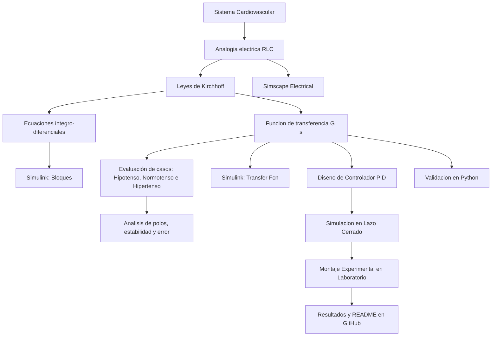

[](https://matlab.mathworks.com/open/github/v1?repo=PradoIT/MSFP2)

# Práctica 2 — Sistema Cardiovascular

Repositorio académico de la asignatura **Modelado de Sistemas Fisiológicos**, correspondiente al programa de **Ingeniería Biomédica** del Tecnológico Nacional de México / Instituto Tecnológico de Tijuana. Esta práctica integra modelado matemático, analogías eléctricas de sistemas fisiológicos, análisis temporal y de estabilidad en diferentes condiciones hemodinámicas, diseño de controladores PID, simulación computacional y comprobación experimental.

El caso de estudio representa el **sistema cardiovascular** mediante un circuito **RLC de segundo orden**. Se busca reproducir y comparar la respuesta de la presión principal/periférica $P_p(t)$ ante diferentes señales de presión arterial aplicada $P_a(t)$, evaluando tres condiciones fisiológicas (Hipotenso, Normotenso e Hipertenso), tanto en lazo abierto como en lazo cerrado con un controlador PID.

**Docente:** Dr. Paul Antonio Valle Trujillo  
**Correo:** paul.valle@tectijuana.edu.mx  
**Departamento:** Ingeniería Eléctrica y Electrónica  
**Institución:** Tecnológico Nacional de México / Instituto Tecnológico de Tijuana  
**Asignatura:** Modelado de Sistemas Fisiológicos  
**Programa:** Ingeniería Biomédica  
**Estudiante:** Prado Acosta Briseida · l23210715 · l23210715@tijuana.tecnm.mx

**Repositorio de la asignatura:** https://github.com/DrPaulValle/MSF-IBF1020  
**Sede:** Blvd. Alberto Limón Padilla s/n, Tijuana, C. P. 22454, B. C., México.

---

<a id="contenido"></a>
## Contenido

1. [Resumen](#resumen)
2. [Competencia y objetivos](#objetivos)
3. [Relación con el temario](#temario)
4. [Modelo físico y analogía eléctrica](#analogia)
5. [Formulación matemática](#modelo)
6. [Análisis temporal y de estabilidad](#analisis)
7. [Señales de entrada y condiciones de simulación](#senales)
8. [Implementación en MATLAB, Simulink y Simscape](#matlab)
9. [Control en lazo cerrado y sintonización PID](#pid)
10. [Reproducción en Python](#python)
11. [Controlador analógico y laboratorio](#laboratorio)
12. [Resultados y verificación cruzada](#resultados)
13. [Flujo de trabajo](#flujo)
14. [Actividades del estudiante](#actividades)
15. [Estructura del repositorio](#estructura)
16. [Requisitos](#requisitos)
17. [Reproducibilidad y entregables](#reproducibilidad)
18. [Referencias](#referencias)

---

<a id="resumen"></a>
## Resumen

La práctica tiene como propósito **reproducir un procedimiento completo de modelado, análisis, simulación y control** del sistema cardiovascular utilizando resultados y materiales de referencia. La dinámica hemodinámica del sistema se aproxima mediante una resistencia arterial $R$, una inductancia $L$, una capacitancia $C$ (compliancia vascular) y una impedancia de carga $Z$, representadas por un circuito eléctrico de segundo orden. A partir de las leyes de Kirchhoff se obtiene un modelo integro-diferencial, su función de transferencia y su correspondiente representación en el dominio del tiempo.

Se estudian el error en estado estacionario y la estabilidad del modelo evaluando sus polos en tres estados fisiológicos característicos: **Hipotenso**, **Normotenso** e **Hipertenso**. Posteriormente se aplican cuatro entradas de referencia —escalón, pulso, rampa y senoide— y se contrastan tres implementaciones en MATLAB/Simulink/Simscape. Se incorpora un **controlador PID con retroalimentación negativa**, cuyas ganancias se sintonizan a partir de criterios de desempeño temporal. Los resultados se reproducen mediante Python y se comparan con la construcción física del circuito y las mediciones experimentales de laboratorio.

**Palabras clave:** circuito RLC; controlador PID; sistema cardiovascular; hemodinámica; presión arterial; estabilidad; MATLAB; Simulink; Simscape Electrical; Python; simulación *in silico*.

[Volver al contenido](#contenido)

---

<a id="objetivos"></a>
## Competencia y objetivos

### Competencia a desarrollar

Comprender los conceptos de Ingeniería de Control, la respuesta temporal y los criterios de estabilidad hemodinámica mediante la reproducción y verificación de un modelo matemático de segundo orden aplicado al sistema cardiovascular. La práctica permite evaluar el comportamiento fisiológico en estados de hipotensión, normotensión e hipertensión mediante herramientas computacionales e instrumentación de laboratorio.

### Objetivo general

Reproducir y verificar el modelo de segundo orden del sistema cardiovascular mediante su formulación matemática, implementación computacional, análisis de estabilidad en tres casos hemodinámicos, control con retroalimentación PID y emulación experimental.

### Objetivos específicos

- Obtener la función de transferencia del sistema $G(s) = P_p(s)/P_a(s)$ a partir de las leyes de Kirchhoff.
- Formular el modelo de ecuaciones integro-diferenciales del circuito analógico.
- Determinar el error en estado estacionario $e(t)$ ante una entrada de presión en escalón unitario.
- Analizar la estabilidad en lazo abierto mediante el cálculo de polos para los estados: **Hipotenso** (subamortiguado), **Normotenso** (sobreamortiguado) e **Hipertenso** (críticamente amortiguado).
- Simular la respuesta del sistema en lazo abierto y lazo cerrado mediante Simulink, Simscape y Python.
- Sintonizar las ganancias de un controlador PID en MATLAB/Simulink para eliminar el error entre la presión deseada y la salida.
- Construir el circuito equivalente y el controlador analógico en el laboratorio para validación física.

[Volver al contenido](#contenido)

---

<a id="temario"></a>
## Relación con el temario

La práctica integra contenidos correspondientes a tres unidades de la asignatura **Modelado de Sistemas Fisiológicos (IBF-1020)**:

| Unidad | Área | Contenidos aplicados |
|---|---|---|
| I | Sistemas de control retroalimentados | Elementos del sistema de control, diagramas de bloques, respuesta ante distintas entradas, análisis de error y criterios de estabilidad |
| II | Modelado matemático | Analogía circuito–sistema cardiovascular, leyes de Kirchhoff, modelo de segundo orden y función de transferencia |
| III | Controladores | Tipos de controladores, diseño del PID y sintonización de ganancias |

[Volver al contenido](#contenido)

---

<a id="analogia"></a>
## Modelo físico y analogía eléctrica

El sistema cardiovascular se aproxima mediante un circuito eléctrico equivalente donde las presiones hidrostáticas/arteriales se representan por voltajes y el flujo sanguíneo por corriente.

| Símbolo | Equivalente eléctrico | Interpretación fisiológica |
|---|---|---|
| $P_a(t)$ | Voltaje de entrada | Presión arterial de entrada / aplicativa |
| $P_p(t)$ | Voltaje de salida | Presión principal / vascular periférica |
| $F(t)$ | Corriente eléctrica | Flujo sanguíneo |
| $R$ | Resistencia | Resistencia vascular periférica |
| $L$ | Inductancia | Inercia del flujo sanguíneo / inductancia vascular |
| $C$ | Capacitancia | Compliancia / elasticidad de los vasos sanguíneos |
| $Z$ | Impedancia | Impedancia vascular de carga |

### Parámetros para los estados hemodinámicos

| Estado Fisiológico | $Z$ | $L$ | $R$ | $C$ | Respuesta del sistema |
|---|---:|---:|---:|---:|---|
| **Hipotenso** | $0.010$ | $0.007$ | $1.000$ | $3.500$ | Estable y Subamortiguado |
| **Normotenso** | $0.010$ | $0.001$ | $1.006$ | $1.500$ | Estable y Sobreamortiguado |
| **Hipertenso** | $0.010$ | $0.007$ | $1.000$ | $1.000$ | Estable y Críticamente amortiguado |

[Volver al contenido](#contenido)

---

<a id="modelo"></a>
## Formulación matemática

### 1. Ecuaciones integro-diferenciales

A partir del análisis de mallas y nodos del sistema equivalente, la corriente/flujo total está definido por las contribuciones de la inductancia, capacitancia y resistencia:

$$F_a(t) = F_Z(t) + F_L(t) = F_C(t) + F_R(t)$$

Expresando las relaciones integro-diferenciales en función de la presión de entrada $P_a(t)$ y la presión de salida $P_p(t)$:

$$P_p(t) = \left[ \frac{1}{L} \int \left( P_a(t) - P_p(t) \right) dt - C \frac{dP_p(t)}{dt} \right] \frac{RZ}{Z+R}$$

### 2. Función de transferencia

Aplicando la Transformada de Laplace con condiciones iniciales nulas:

$$\boxed{\frac{P_p(s)}{P_a(s)} = \frac{LRs + RZ}{CLRZ s^2 + L(Z+R)s + RZ}}$$

[Volver al contenido](#contenido)

---

<a id="analisis"></a>
## Análisis temporal y de estabilidad

### 1. Error en estado estacionario

Para una entrada en escalón unitario $P_a(s) = \frac{1}{s}$, aplicando el Teorema del Valor Final:

$$e(s) = \lim_{s \to 0} s P_a(s) \left( 1 - \frac{P_p(s)}{P_a(s)} \right) = \lim_{s \to 0} s \left( \frac{1}{s} \right) \left( 1 - \frac{LRs + RZ}{CLRZ s^2 + L(Z+R)s + RZ} \right) = 1 - 1 = 0$$

$$\boxed{e(t) = 0\text{ V}}$$

El error en estado estacionario para una entrada escalón unitario en lazo abierto es **0 V**.

### 2. Polos y estabilidad por estado fisiológico

La ecuación característica del sistema está dada por $CLRZ s^2 + L(Z+R)s + RZ = 0$. Resolviendo mediante la fórmula general:

$$\lambda_{1,2} = \frac{-L(Z+R) \pm \sqrt{[L(Z+R)]^2 - 4CLRZ^2}}{2CLRZ}$$

Sustituyendo los parámetros de cada condición fisiológica:

- **Hipotenso:**
  $$\lambda_{1,2} = -14.429 \pm 8.805i$$
  *Resultado:* Polos complejos conjugados con parte real negativa $\rightarrow$ **Sistema estable y subamortiguado**.

- **Normotenso:**
  $$\lambda_1 = -12.062, \quad \lambda_2 = -55.272$$
  *Resultado:* Polos reales negativos y distintos $\rightarrow$ **Sistema estable y sobreamortiguado**.

- **Hipertenso:**
  $$\lambda_1 = -10.0, \quad \lambda_2 = -10.0$$
  *Resultado:* Polos reales negativos e iguales $\rightarrow$ **Sistema estable y críticamente amortiguado**.

[Volver al contenido](#contenido)

---

<a id="senales"></a>
## Señales de entrada y condiciones de simulación

| Señal | Definición para la simulación | Propósito |
|---|---|---|
| Escalón | $u(t) = 1$ para $t \ge 0$ | Evaluar transitorio y verificar error de estado estacionario |
| Pulso | Amplitud $1$, duración $1\,\mathrm{s}$ | Evaluar la respuesta ante cambios súbitos de presión |
| Rampa | $u(t) = t/10$ | Evaluar el seguimiento de variaciones continuas |
| Senoide | $u(t) = \sin(\pi t / 2)$ | Simular la respuesta ante ciclos cardíacos oscilatorios |

[Volver al contenido](#contenido)

---

<a id="matlab"></a>
## Implementación en MATLAB, Simulink y Simscape

El modelo se implementa en MATLAB y Simulink evaluando los tres escenarios fisiológicos (Hipotenso, Normotenso e Hipertenso). Se comparan tres metodologías de simulación:

1. **Ecuaciones integro-diferenciales:** Implementadas mediante bloques de integración y suma en Simulink.
2. **Función de transferencia:** Bloque `Transfer Fcn` cargado con los coeficientes $G(s)$ según los parámetros de cada caso.
3. **Circuito analógico en Simscape:** Implementación con componentes eléctricos pasivos R, L y C.

[Volver al contenido](#contenido)

---

<a id="pid"></a>
## Control en lazo cerrado y sintonización PID

### 1. Retroalimentación negativa

Se aplica un controlador PID con retroalimentación negativa unitaria sobre la función de transferencia para asegurar un seguimiento rápido y eliminar desviaciones ante perturbaciones hemodinámicas.

### 2. Sintonización

Utilizando la herramienta de sintonización de Simulink (`PID Tuner`), se obtienen las ganancias $k_P$, $k_I$ y $k_D$ para satisfacer el criterio de desempeño:
- Tiempo de establecimiento $t_s \le 100\,\mathrm{ms}$
- Sobreimpulso $M_p \le 10\%$

[Volver al contenido](#contenido)

---

<a id="python"></a>
## Reproducción en Python

A través de un script en Python (`.py`), se definen las funciones de transferencia para los tres casos fisiológicos, se calculan los polos del sistema y se simulan las respuestas en lazo abierto y lazo cerrado ante las cuatro señales de entrada.

[Volver al contenido](#contenido)

---

<a id="laboratorio"></a>
## Controlador analógico y laboratorio

### Materiales y equipo
- Resistores, inductores y capacitores para el circuito equivalente.
- Amplificadores operacionales (TL084 / LM358) para la etapa del controlador PID.
- Generador de funciones, fuente de alimentación simétrica ($\pm 15\,\mathrm{V}$) y osciloscopio.

---

<a id="resultados"></a>
## Resultados y verificación cruzada

Se comparan las respuestas numéricas y experimentales para cada entrada y cada estado fisiológico.

### Archivos de resultados

| Entrada | MATLAB/Simulink | Python | Laboratorio (Osciloscopio) |
|---|---|---|---|
| Escalón | `step_matlab.pdf` | `step_python.pdf` | `stepLC.pdf` |
| Pulso | `impulse_matlab.pdf` | `impulse_python.pdf` | `impulseLC.pdf` |
| Rampa | `ramp_matlab.pdf` | `ramp_python.pdf` | `rampLC.pdf` |
| Sinusoidal | `sinusoidal_matlab.pdf` | `sinusoidal_python.pdf` | `sinLC.pdf` |

[Volver al contenido](#contenido)

---

<a id="flujo"></a>
## Flujo de trabajo



[Volver al contenido](#contenido)

---

<a id="actividades"></a>
## Actividades del estudiante

- [x] Derivar la función de transferencia del sistema cardiovascular $G(s) = P_p(s)/P_a(s)$.
- [x] Formular las ecuaciones integro-diferenciales.
- [x] Calcular el error en estado estacionario ante entrada escalón unitario.
- [x] Calcular los polos y analizar la estabilidad para los tres casos: Hipotenso, Normotenso e Hipertenso.
- [ ] Implementar la simulación en Simulink y Simscape para los tres casos.
- [ ] Sintonizar el controlador PID en lazo cerrado.
- [ ] Reproducir los resultados en Python.
- [ ] Implementar y medir el circuito en laboratorio.
- [ ] Subir evidencias y reporte al repositorio de GitHub.

[Volver al contenido](#contenido)

---

<a id="estructura"></a>
## Estructura del repositorio

```text
.
├── README.md                           # Reporte principal y guía de la práctica
├── CITATION.cff                        # Fichero de citación
├── Prado_l23210715.mlx                 # Cuaderno de MATLAB
├── Prado_l23210715.pdf                 # Reporte exportado en PDF
├── sistema_cardiovascular.slx          # Modelo de Simulink/Simscape
├── sistema_cardiovascular.py           # Código en Python
├── controlador_pid.png                 # Parámetros del controlador
├── step_matlab.pdf
├── impulse_matlab.pdf
├── ramp_matlab.pdf
├── sinusoidal_matlab.pdf
├── step_python.pdf
├── impulse_python.pdf
├── ramp_python.pdf
├── sinusoidal_python.pdf
├── stepLC.pdf
├── impulseLC.pdf
├── rampLC.pdf
└── sinLC.pdf
```

[Volver al contenido](#contenido)

---

<a id="requisitos"></a>
## Requisitos

### Software
- **MATLAB R2023a o superior** (Simulink, Simscape Electrical, Control System Toolbox).
- **Python 3.8+** (con `numpy`, `scipy`, `matplotlib`, `control`).
- **VS Code** o Spyder.

### Recursos de laboratorio
- Instrumentación de laboratorio (Osciloscopio, Fuente simétrica, Generador de funciones).

[Volver al contenido](#contenido)

---

<a id="reproducibilidad"></a>
## Reproducibilidad y entregables

1. Clonar el repositorio: `git clone https://github.com/PradoIT/MSFP2.git`
2. Abrir el cuaderno `.mlx` en MATLAB y ejecutar todas las secciones.
3. Ejecutar el archivo `.py` en Python para verificar las gráficas.
4. Comparar las respuestas transitorias entre los casos Hipotenso, Normotenso e Hipertenso.

[Volver al contenido](#contenido)

---

<a id="referencias"></a>
## Referencias

[1] P. A. Valle, Syllabus para Modelado de Sistemas Fisiológicos, Tecnológico Nacional de México / Instituto Tecnológico de Tijuana, Tijuana, B.C., México, 2025. Permalink: https://biomath.xyz/course/

[2] M. C. Khoo, Physiological Control Systems Analysis Simulation, and Estimation, 2nd ed. Piscataway, New Jersey, USA: IEEE Press, 2018.

[3] N. S. Nise, Control Systems Engineering, 8th ed. Hoboken, New Jersey, USA: John Wiley & Sons, 2020.